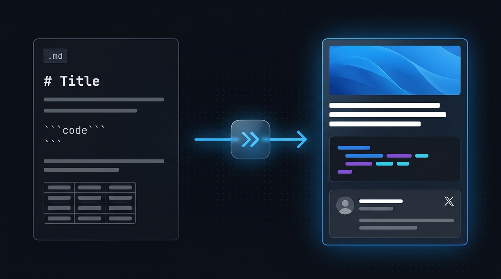
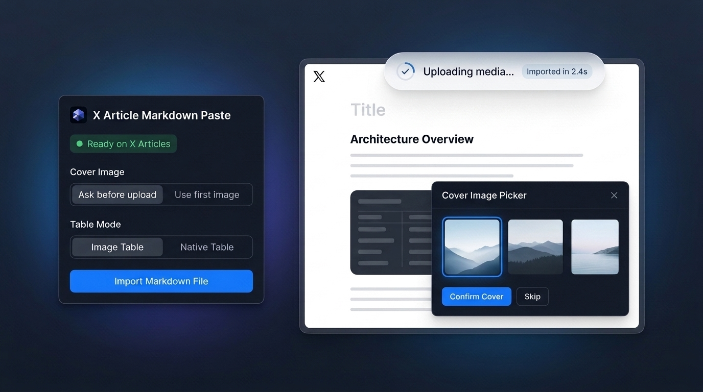
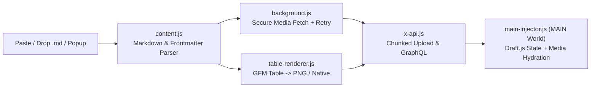

<div align="center">


# X Article Markdown Paste

**One-click Markdown-to-X-Article importer — auto-renders images, videos, code blocks, tables, and tweet embeds directly inside the X Article editor.**

[](manifest.json)
[](manifest.json)
[](#)
[](#)

[English](#-features) · [中文说明](#-核心功能)

<br />



</div>

---

## ✨ Features

Writing long-form articles on **X (Twitter) Articles** usually means manually re-uploading every image, reformatting code blocks, screenshotting tables, and pasting tweet links one by one. **X Article Markdown Paste** turns that entire workflow into a single paste or file drop.

| Capability | Details |
| :--- | :--- |
| **3 Seamless Import Modes** | **Paste** Markdown directly into the editor, **Drag & Drop** `.md` / `.markdown` files onto `x.com/compose/articles`, or **Pick a File** from the extension popup / floating button. |
| **Full Markdown + Frontmatter** | Parses headings, bold/italic, inline code, links (including reference links), lists, blockquotes, horizontal rules, fenced code blocks, and YAML frontmatter (`title` / `标题`, `cover` / `封面`). |
| **Auto Media & Video Upload** | Fetches `https://` and `data:` images (up to 16 MB) & videos (up to 48 MB) in the background service worker with SSRF protection & exponential backoff retry, then runs X's chunked `INIT / APPEND / FINALIZE / STATUS` upload. |
| **Dual Table Rendering Mode** | **Image Table** renders GFM tables into crisp high-DPI PNGs and uploads them automatically; **Native Table** inserts editable `MARKDOWN` atomic blocks. |
| **Smart Cover Image Picker** | Supports `Ask before upload`, `Use first image`, or `Do not set cover`, plus local drag-and-drop custom cover upload and automatic deduplication against body images. |
| **Tweet Embeds** | Automatically converts standalone X/Twitter status URLs into native `TWEET` embed blocks. |
| **Bilingual UI (中文 / EN)** | Auto-detects browser language with one-click switching in the popup, complete with a live progress HUD and cancel support. |

<br />

<div align="center">
  
</div>

---

## 🧩 How It Works



- **Platform Guardrails**: Automatically respects X's 25-image-per-article limit—any media beyond 25 is gracefully preserved as Markdown text instead of failing silently.
- **No Build Step**: Pure vanilla JavaScript (Manifest V3), zero external runtime dependencies.

---

## 🚀 Installation (Load Unpacked)

1. Clone this repository:
   ```bash
   git clone https://github.com/williamdh457/x_copy_transfer.git
   ```
2. Open Chrome and navigate to `chrome://extensions/`.
3. Enable **Developer mode** (top-right toggle).
4. Click **Load unpacked** and select the `x_copy_transfer` folder.
5. Open [x.com/compose/articles](https://x.com/compose/articles) — paste Markdown, drop a `.md` file, or click the extension icon!

---

## 📝 Frontmatter Reference

```yaml
---
title: Your Article Title
cover: https://example.com/cover.png
---
```

- `title` (or `标题`) — Automatically populates the X Article title input and syncs via GraphQL.
- `cover` / `cover_image` (or `封面`) — Automatically sets the article cover image, taking priority over popup settings.

---

## 🇨🇳 核心功能

- **三种导入方式**：在 X 文章编辑器内直接 `Ctrl/Cmd + V` 粘贴 Markdown、将 `.md` / `.markdown` 文件拖入页面，或通过扩展弹窗 / 页面悬浮按钮选择文件导入。
- **自动媒体与表格处理**：自动拉取并分片上传正文图片（最大 16 MB）与视频（最大 48 MB），支持 **图片表格（PNG 渲染）** 与 **原生表格** 双模式切换，推文链接自动转为原生推文嵌入卡片。
- **智能封面与草稿同步**：支持 Frontmatter 指定封面、弹窗选择正文图片或上传本地自定义封面，并通过 MAIN world 注入器同步 Draft.js 编辑器状态与保存草稿。
