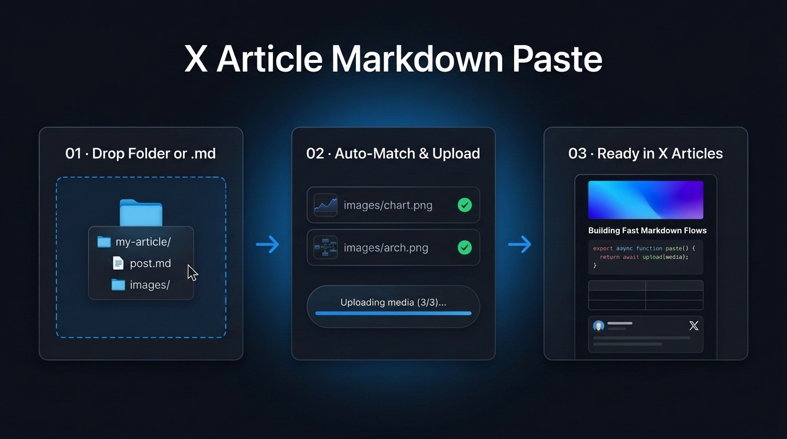
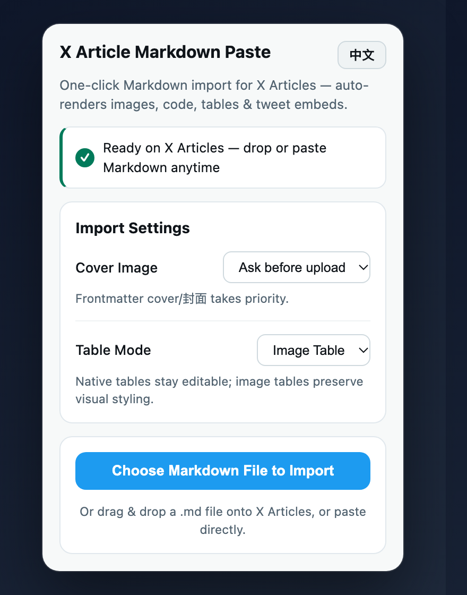
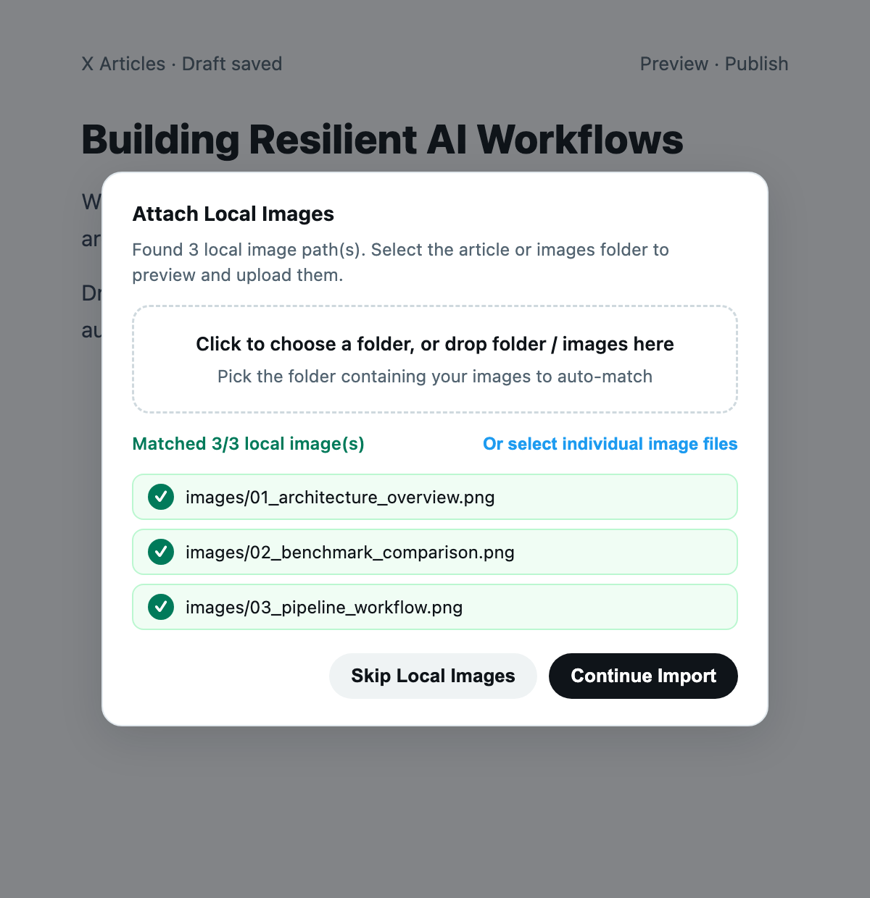
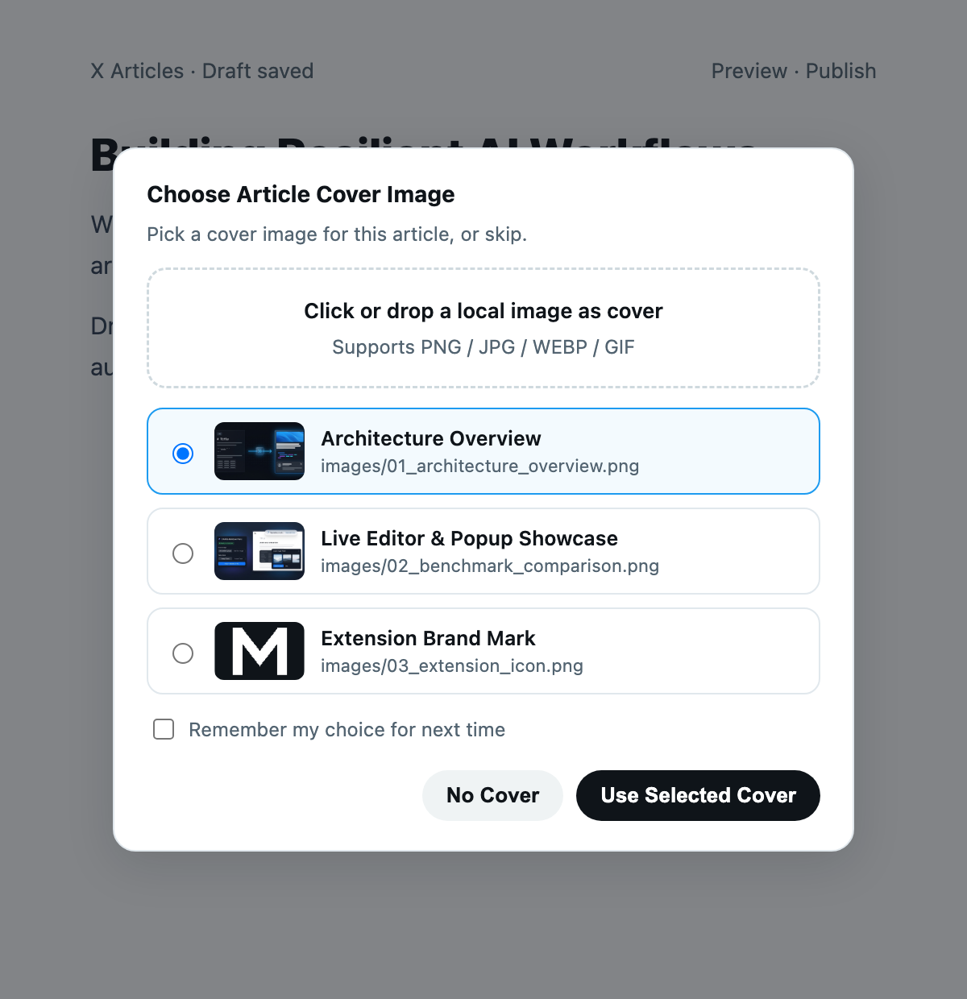
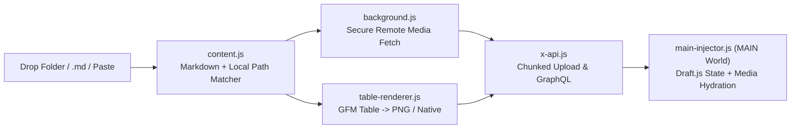

<div align="center">


# X Article Markdown Paste

**Write in Markdown. Drop a folder or paste. Publish on X Articles in seconds.**

*Auto-matches local relative images, uploads media & videos, renders high-DPI tables, formats code blocks, and converts tweet links into native X embeds.*

[](manifest.json)
[](manifest.json)
[](#)
[](#)

[Features](#-features) · [Real UI Screenshots](#-real-ui-screenshots) · [How It Works](#-how-it-works) · [Installation](#-installation-load-unpacked) · [中文说明](#-中文说明)

<br />


</div>

---

## ⚡ 3-Step Workflow

<div align="center">
   Auto-Match & Upload -> Ready in X Articles" width="100%" />
</div>

> Stop manually re-uploading every screenshot, screenshotting Markdown tables, and fixing broken code blocks on X Articles. Just drag your **entire article folder** (`.md` + `images/`) onto `x.com/compose/articles` — or paste Markdown directly — and let the extension handle the rest.

---

## 📸 Real UI Screenshots

Every screen below is captured directly from the live Chrome extension UI:

<table>
  <tr>
    <td align="center" width="33%">
      
      <br />
      <strong>1. Extension Popup</strong>
      <br />
      <sub>Bilingual toggle, Cover & Table modes, and one-click file import</sub>
    </td>
    <td align="center" width="33%">
      
      <br />
      <strong>2. Local Image Auto-Matcher</strong>
      <br />
      <sub>Detects relative paths like <code>images/01_arch.png</code> & matches your folder</sub>
    </td>
    <td align="center" width="33%">
      
      <br />
      <strong>3. Cover Picker with Live Previews</strong>
      <br />
      <sub>Instant thumbnails for local & remote images, plus custom cover drop</sub>
    </td>
  </tr>
</table>

<details>
<summary><strong>Preview: Editor HUD & Layout Concept</strong></summary>
<br />
<div align="center">
  
</div>
</details>

---

## ✨ Features

| Capability | Details |
| :--- | :--- |
| **Folder & File Drop + Paste** | **Drag & Drop** an entire article folder (`.md` + `images/`), drop a single `.md` file, **Paste** Markdown in the editor, or pick a file from the popup / floating button. |
| **Local Relative Image Support** | Automatically resolves relative paths (`images/foo.png`, `./assets/bar.jpg`, macOS NFD/NFC Chinese filenames, URL-encoded paths) from dropped folders or via the built-in folder picker modal. |
| **Full Markdown + Frontmatter** | Parses headings, bold/italic, inline code, links (including reference links), lists, blockquotes, horizontal rules, fenced code blocks, and YAML frontmatter (`title` / `标题`, `cover` / `封面`). |
| **Auto Media & Video Upload** | Fetches `https://`, `data:`, and local images (up to 16 MB) & videos (up to 48 MB) with SSRF protection & exponential backoff retry, then runs X's chunked `INIT / APPEND / FINALIZE / STATUS` upload. |
| **Dual Table Rendering Mode** | **Image Table** renders GFM tables into crisp high-DPI PNGs and uploads them automatically; **Native Table** inserts editable `MARKDOWN` atomic blocks. |
| **Smart Cover Image Picker** | Live thumbnail previews for all candidate images, inline local folder attachment, custom drag-and-drop cover upload, and automatic deduplication against body images. |
| **Tweet Embeds** | Automatically converts standalone X/Twitter status URLs into native `TWEET` embed cards. |
| **Bilingual UI (中文 / EN)** | Auto-detects browser language with one-click switching in the popup, complete with a live progress HUD and cancel support. |

---

## 🧩 How It Works



- **Platform Guardrails**: Automatically respects X's 25-image-per-article limit — any media beyond 25 is gracefully preserved as Markdown text instead of failing silently.
- **No Build Step**: Pure vanilla JavaScript (Manifest V3), zero external runtime dependencies.

---

## 🚀 Installation (Load Unpacked)

1. Clone this repository:
   ```bash
   git clone https://github.com/williamdh457/x_copy_transfer.git
   ```
2. Open Chrome and navigate to `chrome://extensions/`.
3. Enable **Developer mode** (top-right toggle).
4. Click **Load unpacked** and select the `x_copy_transfer` folder.
5. Open [x.com/compose/articles](https://x.com/compose/articles) — drag your article folder (`.md` + `images/`), paste Markdown, or click the extension icon!

---

## 📝 Frontmatter Reference

```yaml
---
title: Your Article Title
cover: images/hero-cover.png
---
```

- `title` (or `标题`) — Automatically populates the X Article title input and syncs via GraphQL.
- `cover` / `cover_image` (or `封面`) — Supports both `https://` URLs and local relative paths; takes priority over popup settings.

---

## 🇨🇳 中文说明

- **一键导入（支持整文件夹拖入）**：直接将包含 `.md` 和 `images/` 的整个文章文件夹拖进 `x.com/compose/articles`，或直接 `Ctrl/Cmd + V` 粘贴 Markdown，或通过扩展弹窗 / 悬浮按钮导入。
- **本地相对路径图片实时预览与上传**：完美支持 Obsidian / Typora 常见的 `images/xxx.png` 本地相对路径（兼容 macOS NFD/NFC 中文文件名）；单拖 `.md` 文件时自动弹出文件夹关联窗口，封面选择器内也可随时一键关联并实时刷新缩略图。
- **富媒体与表格全自动处理**：自动分片上传正文图片（最大 16 MB）与视频（最大 48 MB），支持 **图片表格（高清 PNG）** 与 **原生表格** 双模式切换，推文链接自动转为原生推文嵌入卡片。
- **智能封面与草稿同步**：支持 Frontmatter 指定封面、弹窗缩略图选封面或拖入自定义封面，自动去重正文首图，并通过 MAIN world 注入器实时同步 Draft.js 编辑器状态与草稿保存。
